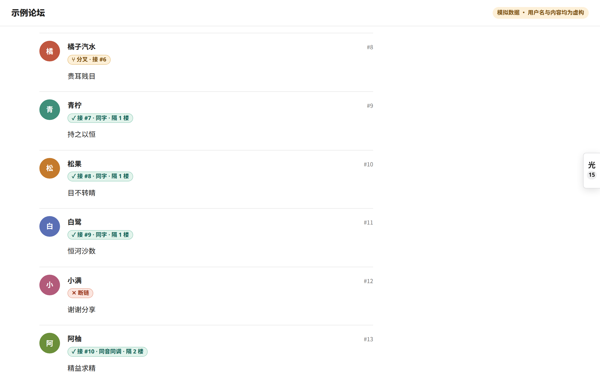
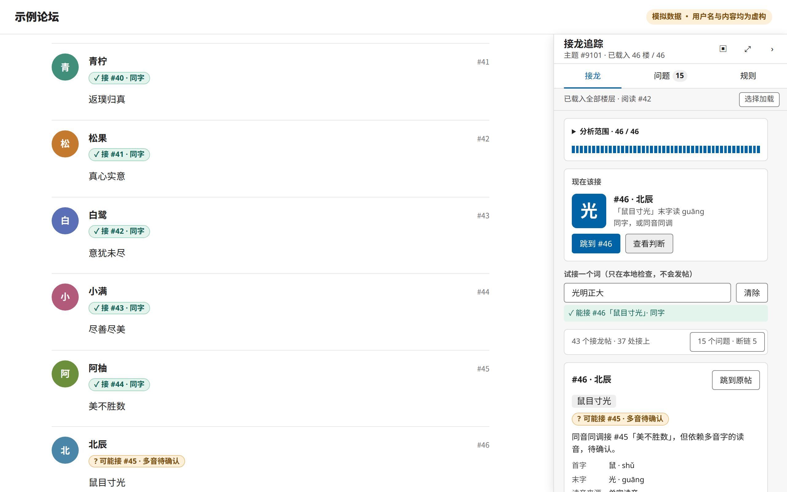
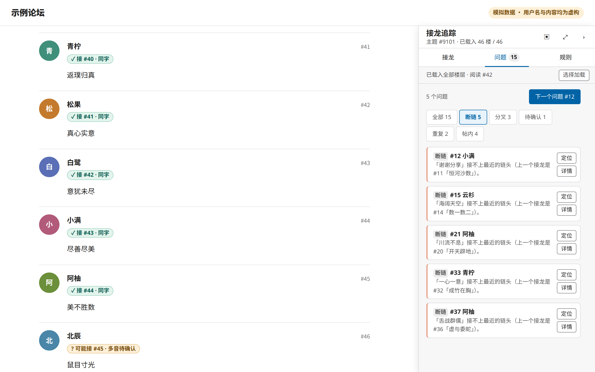
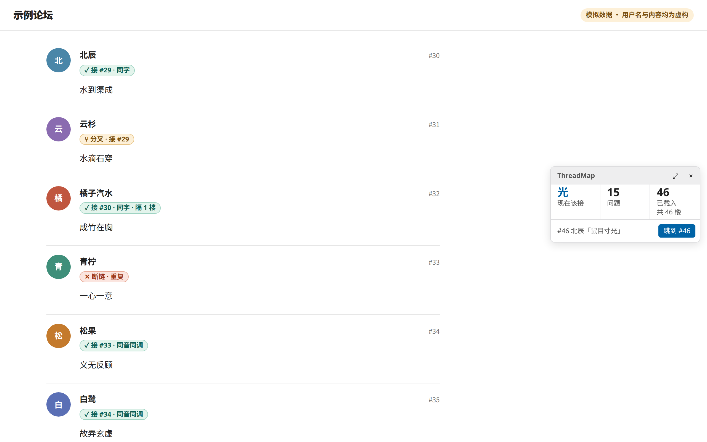
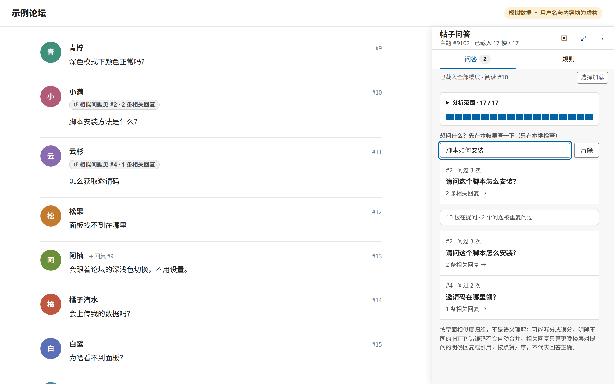
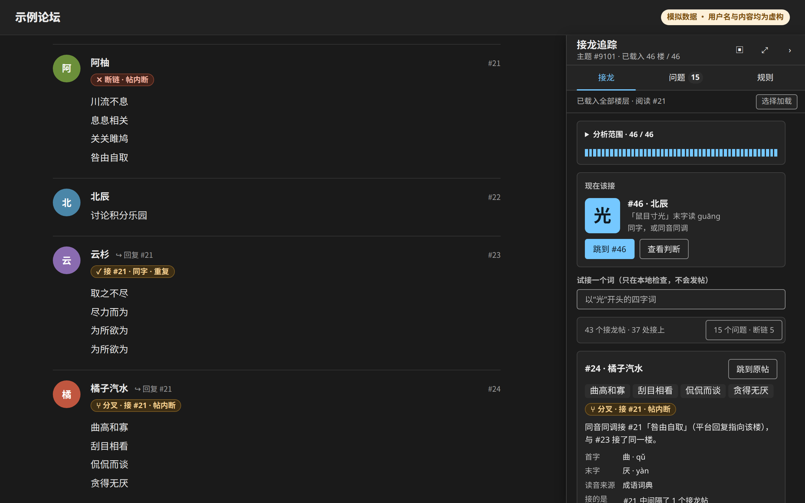
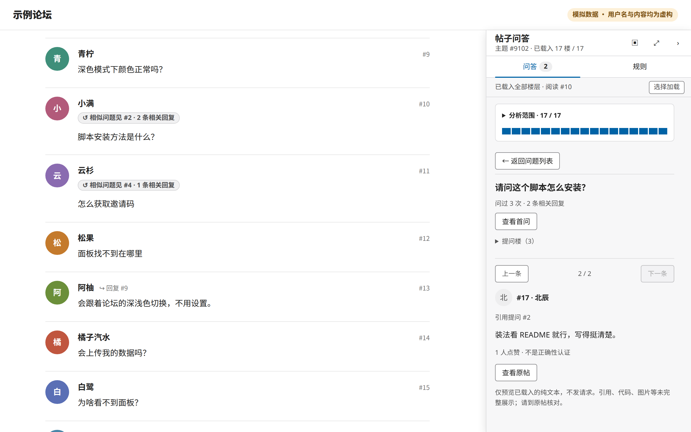

# 展示截图

由 `npm run build && npm run screenshots` 生成，可用 `THREADMAP_CHROME` 指定本地 Chromium。仅手动运行，不接入定时任务或 CI，不调用付费服务。

页面为本地模拟的 Discourse 风格主题，用户名、文字头像、帖子内容均为虚构。浏览器使用全新临时上下文、离线模式，所有页面请求在本地拦截；没有访问 meta.discourse.org 的真实帖子，也不使用登录资料或真实用户截图。这些图片用于展示，不是实站兼容性验证。

当前截图来自未发布工作区，构建标识：45f4ab77ab40，不是公开版 0.2.1 的界面。每张图都保留“模拟数据”标识；请勿裁掉它。视口 1280×800，输出为 2 倍像素密度 PNG（2560×1600），使用真实构建的 `dist/threadmap.user.js`，未后期修改界面或判断结果。

## 01-badges.png

原帖标注：每楼接到哪、分叉（⑂）、断链（✕）；屏幕边缘的按钮显示现在该接的字。

## 02-next.png

现在该接：链头、末字读音，试接一个词看能不能接上。

## 03-issues.png

问题列表：按断链、分叉、待确认、重复筛选，可定位或看详情。

## 04-hud.png

钉成小窗：三格读数，点任意一格展开；拖动标题栏换边。

## 05-qa.png

问答列表：发问前先搜索，只查已载入内容，一步进入相关回复。

## 06-dark.png

深色主题：跟随论坛配色；点原帖标注直接看这楼的判断。

## 07-reader.png

相关回复阅读：保留问题与结构依据，顶部切换，返回原列表而不刷新论坛。

